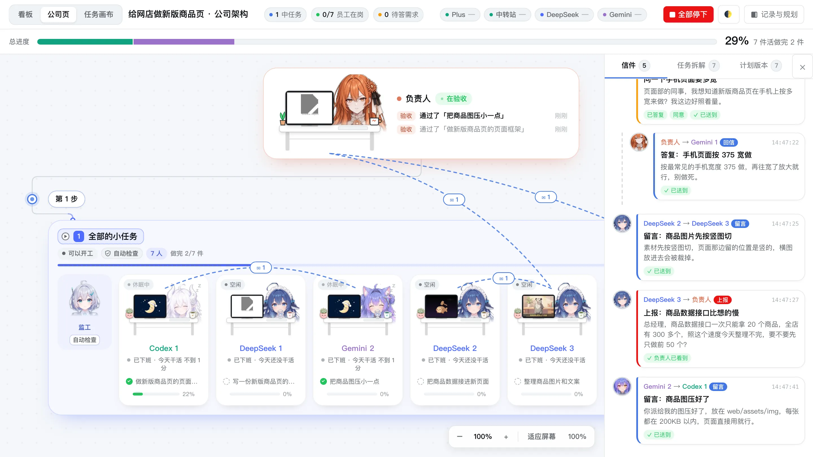
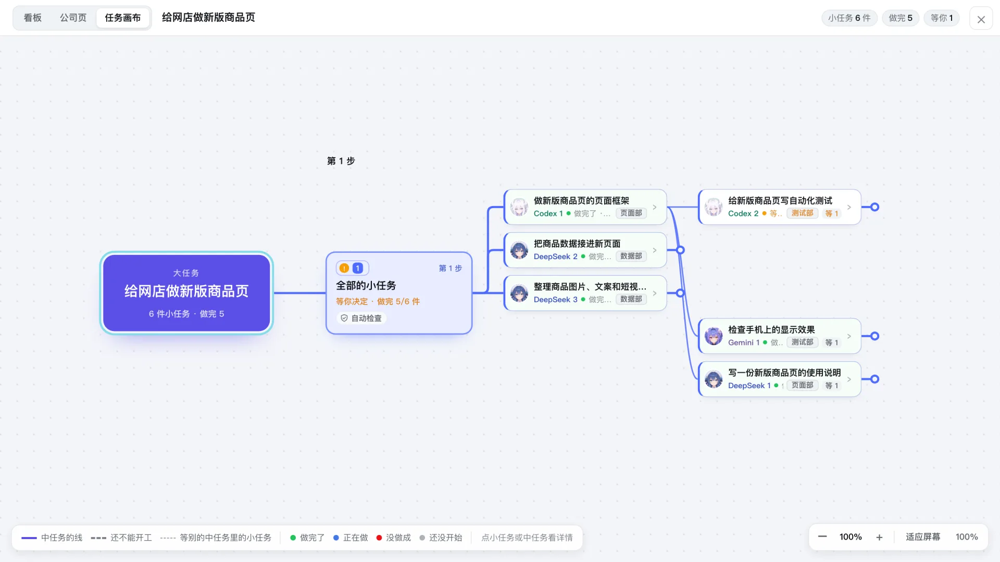
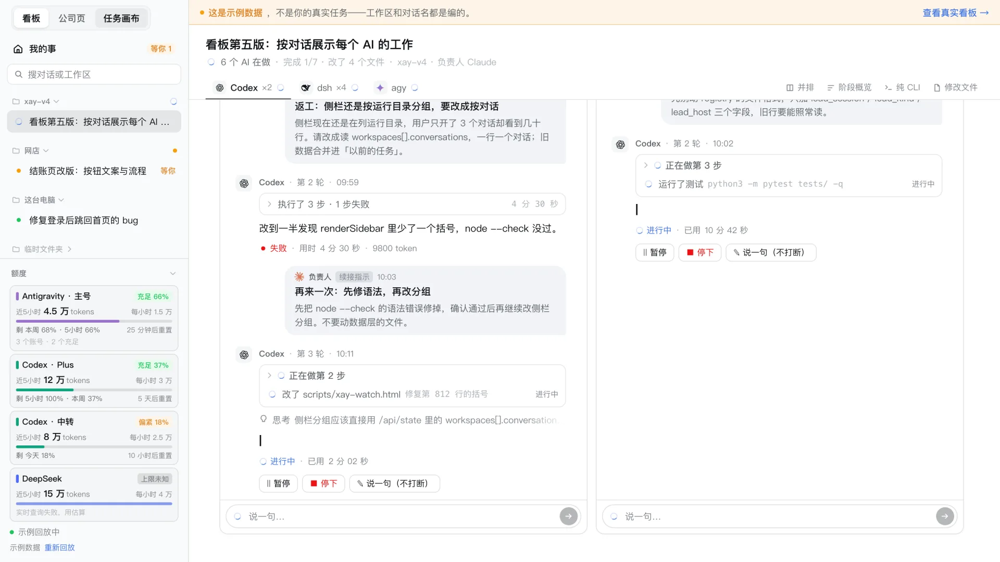

# xay: Multi-AI Collaborative Workplace

> xay turns your everyday AI coding assistants (Claude, Codex, DeepSeek, Gemini) into a coordinated virtual company. A designated lead AI acts as the general manager to decompose complex tasks, while specialized AI teammates execute subtasks in parallel. With real-time web dashboards, you can monitor work progress, visualize task dependency canvases, and manage multi-agent workflows effortlessly.

---

## 这是什么？

一句话：**让你常用的 AI（Claude / Codex / DeepSeek / Gemini）像一个公司一样分工干活。**

主 AI 当“总经理”负责把复杂大活拆解成任务，别的 AI 当“员工”负责各自认领、编码与编写测试，你可以在浏览器网页上实时查看公司页、任务流转画布和执行看板。

---

## 先看一眼


上面是 14 秒预览。完整视频约 2 分钟（mp4，3.8MB）：[**下载 demo.mp4**](https://github.com/Flame929/xay-multiagent/raw/main/docs/media/demo.mp4)。内容是：总经理开部门、招员工、拆任务，员工开工、互相写信、做完被验收，遇到拿不准的事停下来问你。这是示例模式的回放，不是真实任务。

想看看一份计划长什么样、自己试一试？见 [`docs/examples/`](docs/examples/README.md)：三份现成的示例计划。

---

## 环境要求

在开始之前，你的电脑需要准备好以下基础环境：

1. **Python 3.11+** 与 **git**。
2. **至少装一家 AI 的命令行工具**：
   - `codex`（OpenAI / Codex 驱动）
   - `dsh`（DeepSeek 命令行客户端）
   - `agy`（Google Antigravity / Gemini 命令行工具）
   > 提示：无需全部安装，哪家没装哪家的活就派不出去；只要安装了其中任意一个，xay 即可开始为你协同派工。
3. **（可选）Antigravity Tools**：如果使用 Gemini 并配置了多账号轮替，可配合 Antigravity Tools 进行多账号额度预检与自动调度。

---

## 三步上手

### 1. 克隆代码仓库

```bash
git clone https://github.com/Flame929/xay-multiagent.git
cd xay-multiagent
# 将 V2/bin 目录临时加入环境变量，或直接调用 ./V2/bin/xay2
export PATH="$(pwd)/V2/bin:$PATH"
```

### 2. 检查运行环境

运行内置的体检命令，自动检测系统 Python 版本与各家 AI 命令行工具的安装状态：

```bash
xay2 doctor
```

### 3. 启动办公后台与看板

执行以下命令启动 xay 后台服务：

```bash
xay2 office start
```

启动成功后，在浏览器中打开以下两个页面：
- **公司页**：[http://127.0.0.1:7879/org](http://127.0.0.1:7879/org)
- **任务实时看板**：[http://127.0.0.1:7878/](http://127.0.0.1:7878/)

---

## 最小使用示例：让主 AI 用 xay 干活

将本仓库根目录的 [`SKILL.md`](SKILL.md) 提示词提供给你所使用的主 AI（例如 Claude、Codex 或 Gemini）。

### 1. 任务的四层结构
- **大任务**（主 AI 定）：这次对话要完成的整件事。
- **中任务**（主 AI 分）：划分成组，**每个中任务一个监工**；中任务之间有先后步骤，同一步里的可以同时做。
- **小任务**（主 AI 交给某个 AI）：具体交给某个 AI 去做的一件活。
- **步骤**（**AI 自己拆**）：员工 AI 开工前阅读任务卡，自己拆解出具体操作步骤。

### 2. 负责人五步流程
1. **建立大任务**：`xay2 begin --title "大任务名字（大白话）"`
2. **生成计划模板**：`xay2 plan template > plan.json`（得到带中文说明的模板）
3. **填写计划**：主 AI 将模板填好（全部用大白话：中任务写清“做完能得到什么”，小任务标题用大白话，细节写在任务卡里）
4. **预检并生效**：运行 `xay2 plan apply --dry-run plan.json` 检查，确认无误后执行 `xay2 plan apply plan.json` 一次建好
5. **程序自动执行**：后续全由程序自动推进——自动派人、员工 AI 自己拆解步骤、监工验收、自动生成大白话汇报并在网页上展现

---

## 页面上能看到什么？

- **公司页（http://127.0.0.1:7879/org）**：每个中任务一个房间、能看到谁在做什么、谁做完在休息；员工之间写的信在右边。

  

  遇到拿不准的事，页面顶上会弹出"需要你"，由你来定：

  
- **任务画布**：一步一步、哪几组同时做、每件小任务做到哪。

  
- **实时看板（http://127.0.0.1:7878/）**：展示每个小任务的流转状态、对话详情、改动内容与控制台。

  

> 上面的截图和视频都来自**示例模式**：回放一个编好的小故事，不消耗任何 AI 额度，也不会读到你的真实数据。启动后打开 <http://127.0.0.1:7879/org?demo=1> 就能自己看。

---

## 常见问题（FAQ）

### Q: 默认端口（7878 或 7879）被占用了怎么办？
**A**: 可以在启动时通过 `--port` 参数指定新端口，或设置环境变量 `XAY2_BOARD_PORT`：
```bash
xay2 office start --port 7882
# 或：
export XAY2_BOARD_PORT=7882
xay2 office start
```

### Q: 某家 AI 没有安装或配置，能用吗？
**A**: 完全可以。xay 支持异构 AI 弹性协同，未安装的 AI 只是无法被分配该类型的任务卡，只要系统里至少有一种可用的 AI 工具（例如已安装好 `agy` 或 `dsh`），就可以正常分工干活。

### Q: 启动提示 Python 版本不够怎么办？
**A**: xay V2 基于 Python 3.11 标准库特性开发，无需第三方依赖，但要求最低 Python 3.11。请使用 Homebrew、pyenv、conda 或官方安装包升级你的 Python。

### Q: 运行产生的数据和临时文件存放在哪里？怎么彻底重置？
**A**: 所有运行时数据、账本和工位工作区默认存放在用户主目录下的 `~/.xay/v2`。如果需要彻底推倒重来，直接删除该目录即可：
```bash
rm -rf ~/.xay/v2
```
> **注意**：这样会删掉所有历史记录和员工的工作笔记。重新启动 `xay2 office start` 会自动初始化干净的全新环境，不会影响当前代码仓库。

---

## 许可证（License）

- 代码：**MIT 许可证**，版权人 Flame929，全文见 [`LICENSE`](LICENSE)。可以自由使用、修改、商用，保留版权声明即可。
- 角色立绘（`scripts/xay-chars/img/`、`V2/web/chars/img/` 两个文件夹里的图片）：**不适用 MIT**，按 **CC BY-NC-SA 4.0** 授权（署名、非商业使用、相同方式共享），**请勿商用**。来源和作者署名见 [`scripts/xay-chars/img/LICENSE.md`](scripts/xay-chars/img/LICENSE.md)。

---

## 维护说明

如果你是仓库维护者或准备参与 xay 的底层功能开发，请参阅：
- [xay 维护说明与内部结构备忘](docs/维护说明.md)
- [开发者与 AI 协作规范 (AGENTS.md)](AGENTS.md)
